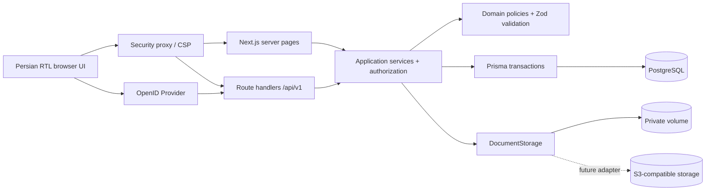
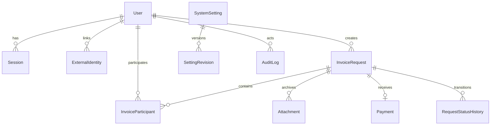
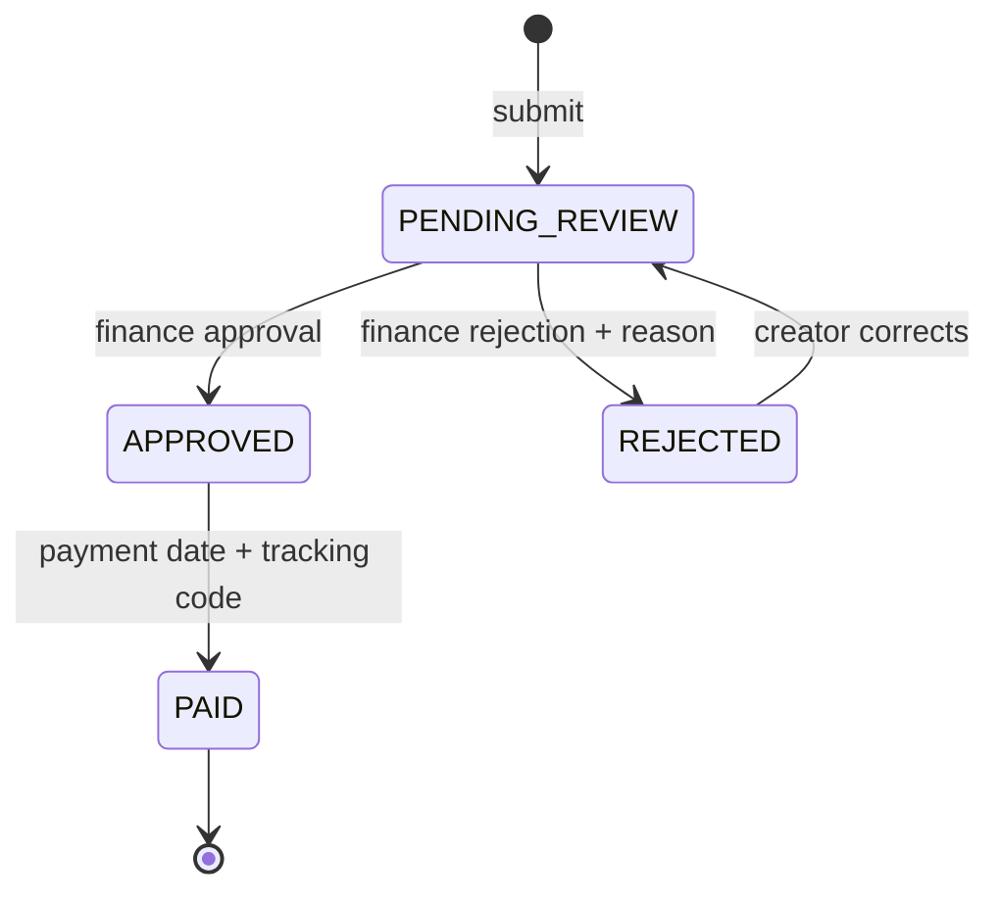

# InvoiceFlow Architecture

**Status:** implemented · **Version:** 2.0 · **Updated:** 2026-09-05

## Product boundary

InvoiceFlow is an invoice intake, review, reimbursement, and archive application. It deliberately supports two explicit workflows rather than becoming an unbounded accounting suite:

1. **Lunch invoices** — a requester selects participants and reimbursement is capped by the active per-person lunch allowance.
2. **Specialist purchases** — electronics/laboratory items are categorized as IC, MOSFET, module, sensor, PCB, tool, or other and the reviewed invoice amount is approved.

It is not a general ledger, inventory system, procurement ERP, or bank-transfer service. Payments are executed outside the app and recorded with a date and tracking code.

## Architecture overview

InvoiceFlow is a modular monolith. Browser UI, server-rendered pages, HTTP route handlers, domain policies, and application services are deployed as one stateless Next.js service. PostgreSQL and private document storage hold durable state.



### Key decisions

| Concern        | Decision                                                                  |
| -------------- | ------------------------------------------------------------------------- |
| Runtime        | Next.js 16 App Router, React 19, TypeScript strict mode                   |
| UI             | Tailwind CSS, accessible Radix/shadcn-style primitives, mobile-first RTL  |
| Persistence    | PostgreSQL 17, Prisma migrations, integer toman amounts                   |
| Dates          | Jalali at the UI boundary; PostgreSQL `DATE`/Gregorian internally         |
| Authentication | Local adapter and standards-based OpenID Connect; local/oidc/hybrid mode  |
| Sessions       | Random opaque tokens; only an HMAC hash is persisted; HttpOnly cookies    |
| Authorization  | RBAC plus creator ownership in the application/DAL layer                  |
| Files          | Private storage keys in PostgreSQL; bytes never stored in DB or `public/` |
| Audit          | Append-only audit rows inside the same transaction as financial mutations |
| Deployment     | Standalone Next.js image, migration job, PostgreSQL, persistent volumes   |

## Module boundaries

```text
src/
├── app/
│   ├── (auth)/login/              # Local and OIDC login experience
│   ├── (dashboard)/               # Protected server-rendered UI
│   │   ├── invoices/              # Simple employee flow
│   │   ├── admin/                 # Review, users, settings, reports, audit
│   │   └── profile/               # Bank and local password profile
│   └── api/
│       ├── health/                # Liveness and readiness
│       └── v1/                    # Versioned HTTP interface
├── components/                    # Reusable UI and forms
├── lib/                           # Environment, DB, HTTP, security, i18n
├── modules/
│   ├── attachments/               # Validation and DocumentStorage adapter
│   ├── audit/                     # Append-only audit writer/query
│   ├── dashboard/                 # Aggregate metrics
│   ├── identity/                  # Identity provider, OIDC, session, RBAC
│   ├── invoice-requests/          # Validation, duplicate check, correction, policy
│   ├── reports/                   # Shared monthly query, CSV/XLSX serializers
│   ├── reviews/                   # Approval, rejection, payment transitions
│   ├── settings/                  # Typed settings and revisions
│   └── users/                     # User admin and encrypted bank profile
├── proxy.ts                       # Optimistic auth redirect + response CSP
prisma/
├── schema.prisma
├── migrations/
└── seed.ts
```

HTTP handlers translate requests and responses only. Authorization and business invariants remain in application services so direct handler reuse cannot bypass them.

## Domain model



`InvoiceRequest.category` discriminates the workflow. Database checks require specialist purchases to have a title and purchase category, require positive financial values, and require complete approval snapshots. Participant uniqueness and payment uniqueness are enforced by compound/unique indexes.

## Request lifecycle



- Only the creator may correct a rejected request.
- Category cannot change during correction.
- The approval calculation and relevant lunch allowance/participant count are snapshotted.
- `PAID` has no outgoing transition and is immutable in both policy and HTTP design.
- Optimistic `version` checks reject concurrent administrative actions.

## Authentication architecture

### Local

`LocalIdentityProvider` verifies Argon2id hashes. Login attempts are throttled using a hashed username/network key. Password changes revoke other sessions.

### OpenID Connect

OIDC uses Authorization Code with PKCE S256, state, and nonce. A short-lived HttpOnly transaction cookie is AES-256-GCM encrypted from the session secret. Provider discovery and token validation use `openid-client`.

Identity resolution order:

1. Match `ExternalIdentity(provider, subject)`.
2. If the provider asserts `email_verified=true`, link an existing normalized email.
3. If `OIDC_AUTO_PROVISION=true`, create a least-privileged `USER` account.
4. Otherwise deny access without disclosing internal account details.

OIDC never assigns administrative roles. Role elevation remains a super-administrator action.

## Security model

### Trust boundaries

- All browser input, filenames, MIME declarations, OIDC claims, query parameters, and proxy headers are untrusted.
- Route protection in `proxy.ts` is only an early redirect. Every API/page data operation resolves the database session and performs server-side authorization.
- Ordinary users receive `404` when attempting to read another creator's request to reduce identifier disclosure.

### Controls

- HttpOnly, `SameSite=Lax`, production `Secure` cookies; revocable server sessions.
- Same-origin enforcement for browser mutations and a restrictive Content Security Policy.
- Zod at input boundaries and parameterized Prisma queries.
- Magic-byte MIME detection, explicit allow-list, byte limit, sanitized original names, SHA-256 digest.
- Safe path resolution and owner-only permissions in local document storage.
- Bank card and IBAN encrypted with AES-256-GCM; key identifiers support rotation.
- Audit metadata excludes passwords, full bank data, session tokens, and file bytes.
- Containers run read-only with `no-new-privileges`; storage is an explicit volume.

### Remaining operator responsibilities

Terminate TLS at a trusted reverse proxy, protect database/storage backups, rotate secrets, configure IdP logout/session policy, centralize logs, scan uploaded documents if the risk profile requires it, and perform restore drills.

## File storage

The `DocumentStorage` interface exposes staged write, promote, read, remove, and exists operations. Local objects are archived under:

```text
storage/{invoices|receipts|food-images|supporting-documents}/YYYY_JALALI/MM/request-id/object-id.ext
```

Storage keys are never public URLs. Downloads pass through an authenticated handler that verifies ownership/admin access and sets private no-store headers. The schema and application boundary are ready for an S3-compatible adapter without changing invoice business logic.

## Reliability and operations

- Financial state changes and audit events share serializable/atomic database transactions.
- `/api/health/live` checks the process; `/api/health/ready` checks database, mandatory settings, and storage.
- The Docker Compose migration service completes before the web service starts.
- PostgreSQL and document bytes use separate persistent volumes and must be backed up as one recovery set.
- JSON financial amounts are serialized as decimal strings to avoid JavaScript precision loss.

## Extensibility rules

New invoice categories should be explicit domain workflows with their own required fields and approval policy. Do not add a free-form category that silently changes financial semantics. New identity/storage providers implement the existing boundary; domain services must not import vendor SDKs directly.
