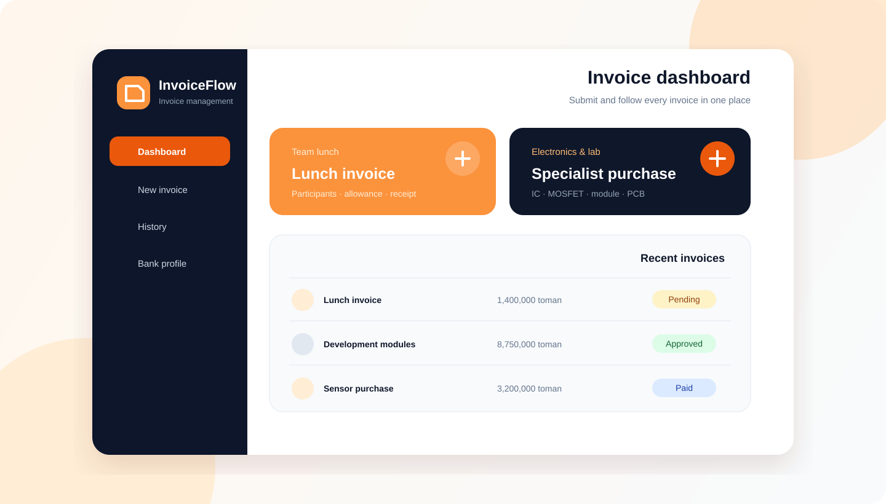

<div align="center" dir="rtl">
  
  <h1>InvoiceFlow — سامانه مدیریت فاکتور</h1>
  <p><strong>یک پایهٔ متن‌باز، فارسی و آمادهٔ استقرار برای ثبت، تأیید، پرداخت و بایگانی فاکتورها</strong></p>
  <p><a href="./README.md">English</a> · <a href="./ARCHITECTURE.md">معماری</a> · <a href="./DEPLOYMENT.md">استقرار</a></p>
</div>

InvoiceFlow فرایندهای پراکنده در پیام‌رسان و فایل‌های Excel را به یک گردش‌کار امن و قابل ممیزی تبدیل می‌کند. دو مسیر مستقل برای «فاکتور ناهار» و «خرید تخصصی آزمایشگاه/الکترونیک» دارد؛ از آی‌سی و ماسفت تا ماژول، سنسور، PCB و ابزار.



## امکانات اصلی

- رابط کاملاً فارسی، راست‌به‌چپ، واکنش‌گرا و دارای تم روشن/تیره
- فرم سادهٔ کاربر عادی: انتخاب نوع، تکمیل اطلاعات ضروری و آپلود مدارک
- نمایش تاریخ شمسی در رابط و نگهداری تاریخ میلادی در PostgreSQL
- محاسبهٔ ناهار بر اساس سهمیهٔ قابل تنظیم و محاسبهٔ مستقل خرید تخصصی
- گردش‌کار «در انتظار بررسی، تأیید، رد، پرداخت» و قفل دائمی رکورد پرداخت‌شده
- اسناد خصوصی خارج از public و بانک اطلاعاتی، همراه با کنترل MIME و اندازه
- نقش‌های ‌`USER`، ‌`FINANCE_ADMIN` و ‌`SUPER_ADMIN`
- ورود محلی و OpenID Connect SSO در حالت‌های local، oidc و hybrid
- گزارش CSV و Excel سازگار با فارسی و دارای ارجاع مدارک
- ثبت ممیزی تمام عملیات مالی، امنیتی و مدیریتی
- Docker، migration، seed، health check، Vitest، Playwright و CI گیت‌هاب

## اجرای سریع بدون Docker

با Node.js نسخهٔ ۲۰٫۹ یا جدیدتر:

```bash
npm ci
npm run dev:local
```

این دستور PostgreSQL واقعی و ایزوله را در پوشهٔ نادیده‌گرفته‌شدهٔ ‌`.local` اجرا می‌کند، کلیدهای امن توسعه را می‌سازد، migration و seed را انجام می‌دهد و برنامه را روی ‌`http://localhost:3000` بالا می‌آورد. رمز حساب‌های اولیه در ترمینال نمایش داده و فقط در فایل ‌`.env` نگهداری می‌شود.

## اجرای Docker

```bash
cp .env.example .env
# همه مقادیر حساس را تغییر دهید
docker compose up --build -d
docker compose run --rm -e SEED_DEFAULT_PASSWORD='یک-رمز-موقت-قوی' migrate npm run db:seed
```

جزئیات کامل متغیرهای محیطی، reverse proxy، backup و استقرار امن در [DEPLOYMENT.md](./DEPLOYMENT.md) آمده است.

## راه‌اندازی SSO

برای اجبار SSO مقدار ‌`AUTH_PROVIDER=oidc` و برای نمایش هم‌زمان ورود محلی و سازمانی مقدار ‌`AUTH_PROVIDER=hybrid` را قرار دهید. سپس این مقادیر را تکمیل کنید:

```dotenv
OIDC_ISSUER_URL=https://id.example.com/realms/company
OIDC_CLIENT_ID=invoice-flow
OIDC_CLIENT_SECRET=...
OIDC_REDIRECT_URI=https://invoice.example.com/api/v1/auth/oidc/callback
OIDC_SCOPES=openid profile email
OIDC_AUTO_PROVISION=false
```

ساخت خودکار کاربر به‌صورت پیش‌فرض خاموش است. در حالت روشن نیز کاربر جدید فقط نقش کم‌دسترسی ‌`USER` می‌گیرد.

## تحویل به تیم فنی

```bash
npm run format:check
npm run lint
npm run typecheck
npm test
npm run build
```

برای مشارکت، [CONTRIBUTING.md](./CONTRIBUTING.md)، مستند [معماری](./ARCHITECTURE.md)، [دیتابیس](./DATABASE.md) و [API](./API_DOCUMENTATION.md) را ببینید.

## مجوز

پروژه با مجوز [MIT](./LICENSE) منتشر می‌شود و هیچ وابستگی به نام یا زیرساخت سازمان مشخصی ندارد؛ نام، لوگو، تنظیمات ورود و استقرار قابل جایگزینی‌اند.
